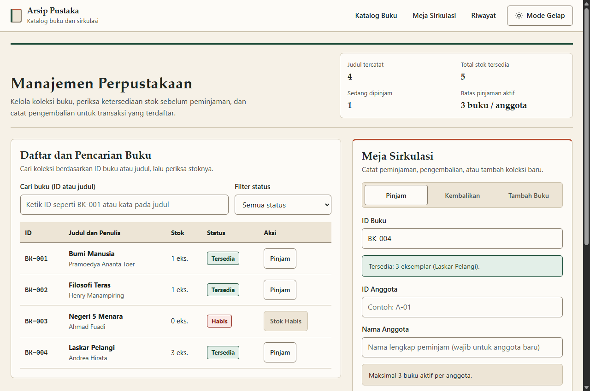
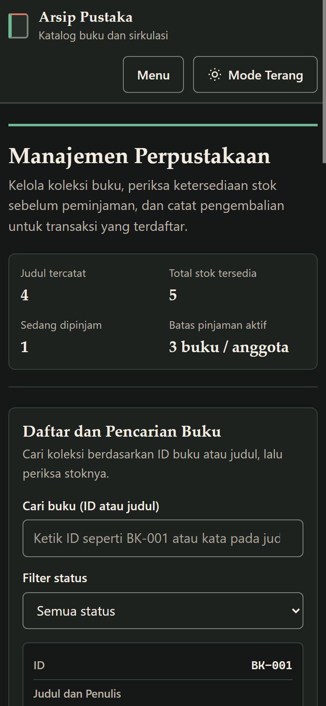
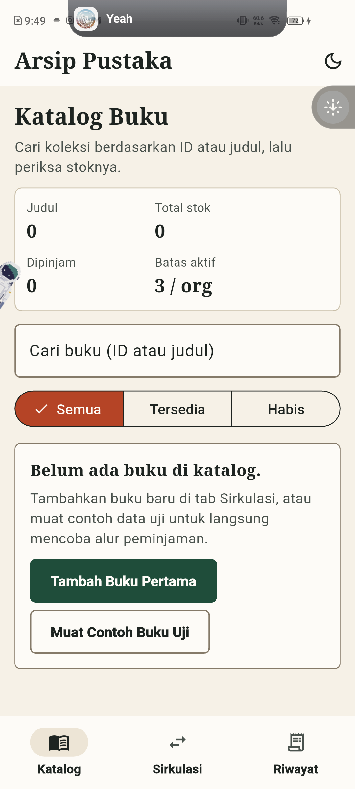
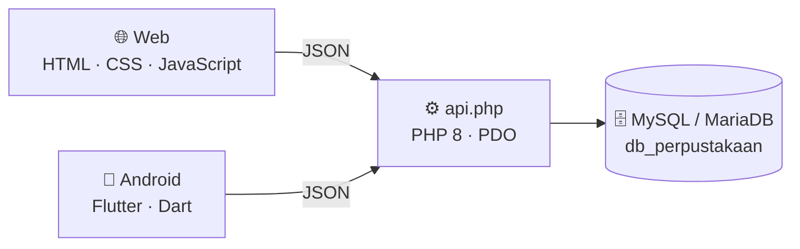
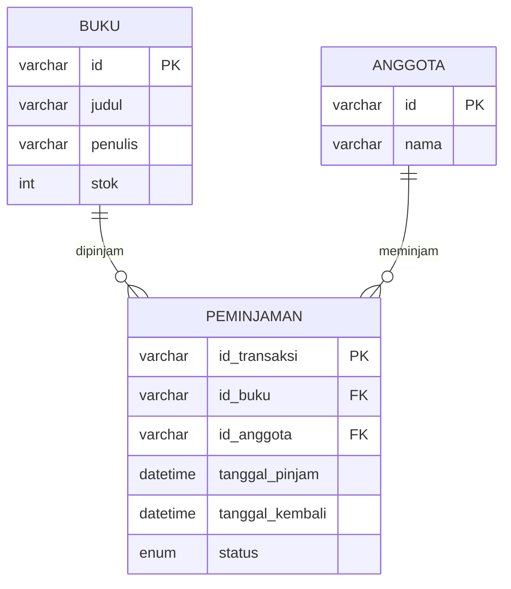

<div align="center">

# 📚 Arsip Pustaka

### Manajemen Perpustakaan — Web & Android

Katalog buku, pencatatan peminjaman, dan pengembalian dalam satu sistem.
Satu API (PHP + MySQL) melayani dua antarmuka: **web responsif** dan **aplikasi Android Flutter**.

[](#-teknologi)
[](#-teknologi)
[](#-teknologi)
[](#-teknologi)
[](#-fitur)

</div>



---

## ✨ Fitur

| Kemampuan | Web | Android |
|---|:---:|:---:|
| Katalog buku dengan pencarian ID/judul | ✅ | ✅ |
| Filter status **Tersedia / Habis** | ✅ | ✅ |
| Tambah buku beserta stok | ✅ | ✅ |
| Pencatatan peminjaman | ✅ | ✅ |
| Pencatatan pengembalian | ✅ | ✅ |
| Riwayat transaksi | ✅ | ✅ |
| Statistik ringkas (judul, stok, dipinjam, batas) | ✅ | ✅ |
| Mode gelap / terang | ✅ | ✅ |
| Muat data contoh untuk pengujian | ✅ | ✅ |
| Reset seluruh data database | ✅ | ✅ |

**Aturan yang dijaga sistem**

- Stok `0` → buku berstatus **Habis** dan tidak bisa dipinjam.
- Satu anggota maksimal **3 pinjaman aktif**.
- Pengembalian hanya untuk transaksi yang tercatat dan masih berstatus `Dipinjam`.
- Setiap operasi tulis berjalan dalam **transaksi SQL** dengan `SELECT ... FOR UPDATE`, sehingga stok tidak bisa minus saat ada permintaan bersamaan.

---

## 🖼️ Tangkapan Layar

| Web — desktop | Web — mobile (mode gelap) | Android |
|:---:|:---:|:---:|
|  |  |  |

---

## 🏗️ Arsitektur



Kedua klien memakai kontrak API yang sama. Model domain (`Buku`, `Anggota`, `Peminjaman`, `Perpustakaan`) diimplementasikan dua kali — JavaScript di `web/perpustakaan.js` dan Dart di `app/lib/perpustakaan.dart` — dengan aturan bisnis yang identik.



---

## 🗂️ Struktur Repo

```text
.
├── web/                         # Klien web + API
│   ├── index.html
│   ├── style.css
│   ├── app.js                   # UI, state, dan pemanggilan API
│   ├── perpustakaan.js          # Model domain JavaScript
│   ├── api.php                  # REST API + auto-migrasi database
│   ├── test.js                  # Unit test model domain (Node)
│   └── database/
│       └── db_perpustakaan.sql
├── app/                         # Aplikasi Android (Flutter)
│   ├── lib/
│   │   ├── main.dart            # UI, navigasi, dan state
│   │   └── perpustakaan.dart    # Model domain + klien API
│   ├── test/widget_test.dart
│   ├── android/
│   └── pubspec.yaml
├── screenshots/
│   ├── web/
│   └── app/
└── README.md
```

---

## 🚀 Cara Menjalankan

### Prasyarat

| Kebutuhan | Versi |
|---|---|
| XAMPP (Apache + MySQL/MariaDB) | PHP 8.0+ |
| Flutter SDK (untuk aplikasi Android) | Dart 3.13+ |
| Node.js (opsional, untuk unit test web) | 18+ |

### 1. Aplikasi Web

1. Nyalakan **Apache** dan **MySQL** di XAMPP Control Panel.
2. Salin folder `web/` ke `htdocs`:

   ```powershell
   Copy-Item -Recurse web C:\xampp\htdocs\manajemen_perpustakaan
   ```

3. Buka `http://localhost/manajemen_perpustakaan/`.

Database `db_perpustakaan` beserta tabelnya **dibuat otomatis** oleh `api.php` saat pertama kali diakses. Jika ingin impor manual, gunakan `web/database/db_perpustakaan.sql`.

> Konfigurasi database ada di bagian atas `web/api.php` (`root`, tanpa sandi, port `3306`). Port bisa dioverride lewat environment variable `PERPUSTAKAAN_DB_PORT`.

### 2. Aplikasi Android

```bash
cd app
flutter pub get
flutter run --dart-define=API_BASE_URL=http://<IP-LAPTOP>/manajemen_perpustakaan/api.php
```

Build APK rilis:

```bash
flutter build apk --release --dart-define=API_BASE_URL=http://<IP-LAPTOP>/manajemen_perpustakaan/api.php
```

- Ganti `<IP-LAPTOP>` dengan IP komputer yang menjalankan XAMPP, misalnya `192.168.3.144`.
- HP dan laptop harus berada di **jaringan Wi-Fi yang sama**.
- Jika koneksi ditolak, izinkan Apache melewati Windows Firewall.

---

## 🔌 API

Base URL: `http://localhost/manajemen_perpustakaan/api.php`

| Method | Aksi | Body JSON | Keterangan |
|---|---|---|---|
| `GET` | `state` | — | Ambil seluruh data (buku, anggota, peminjaman, batas pinjaman) |
| `POST` | `tambah_buku` | `{"id","judul","penulis","stok"}` | Tambah buku baru |
| `POST` | `muat_contoh` | `{}` | Muat 4 buku contoh untuk pengujian |
| `POST` | `pinjam` | `{"idBuku","idAnggota","namaAnggota"}` | Catat peminjaman; anggota baru otomatis terdaftar |
| `POST` | `kembali` | `{"idTransaksi"}` | Catat pengembalian dan tambah stok |
| `POST` | `reset` | `{}` | Kosongkan seluruh data |

Contoh:

```bash
curl "http://localhost/manajemen_perpustakaan/api.php?aksi=state"

curl -X POST "http://localhost/manajemen_perpustakaan/api.php?aksi=pinjam" \
  -H "Content-Type: application/json" \
  -d '{"idBuku":"BK-001","idAnggota":"A-01","namaAnggota":"Rahmat"}'
```

Respons selalu berbentuk:

```json
{
  "status": true,
  "pesan": "Peminjaman TRX-001 untuk \"Bumi Manusia\" atas nama Rahmat berhasil dicatat.",
  "data": {
    "batasPinjaman": 3,
    "koleksiBuku": [],
    "daftarAnggota": [],
    "daftarPeminjaman": []
  }
}
```

Kode status yang dipakai: `200`, `201` (data dibuat), `400` (validasi), `404` (tidak ditemukan), `409` (konflik stok/kuota/duplikat), `500` (koneksi database).

---

## 📏 Aturan Bisnis

1. **Tambah buku** — ID, judul, dan penulis wajib; stok bilangan bulat ≥ 0; ID unik (tidak peka huruf besar/kecil).
2. **Peminjaman** — buku harus ada dan stok > 0; anggota baru wajib menyertakan ID + nama; jika ID sudah terdaftar, nama harus cocok.
3. **Batas pinjaman** — maksimal **3 transaksi aktif** per anggota.
4. **Pengembalian** — hanya untuk ID transaksi yang ada dan berstatus `Dipinjam`; stok bertambah 1 dan `tanggal_kembali` diisi.
5. **ID transaksi** — dibuat otomatis dengan format `TRX-001`, `TRX-002`, dan seterusnya tanpa bentrok.

---

## 🧪 Pengujian

```bash
# Unit test model domain web
cd web
node test.js

# Widget test Flutter
cd app
flutter test
```

`web/test.js` menguji kelas `Buku`, `Anggota`, `Peminjaman`, dan `Perpustakaan` memakai `node:assert/strict`.

---

## 🔐 Catatan

- Kredensial database default (`root` tanpa sandi) hanya untuk **server lokal XAMPP**. Ganti sebelum dipakai di lingkungan nyata.
- Repo ini berisi **source code saja** — APK hasil build dan arsip ZIP tidak disertakan. Build sendiri dengan perintah di atas.
- Folder `build/`, `.dart_tool/`, `.gradle/`, dan `local.properties` dikecualikan lewat `.gitignore`.

---

## 👤 Author

**Rahmat Rifai**

- GitHub: [@Rahmat-Rifai](https://github.com/Rahmat-Rifai)
- Repo: [Rahmat-Rifai/manajemen-perpustakaan](https://github.com/Rahmat-Rifai/manajemen-perpustakaan)
